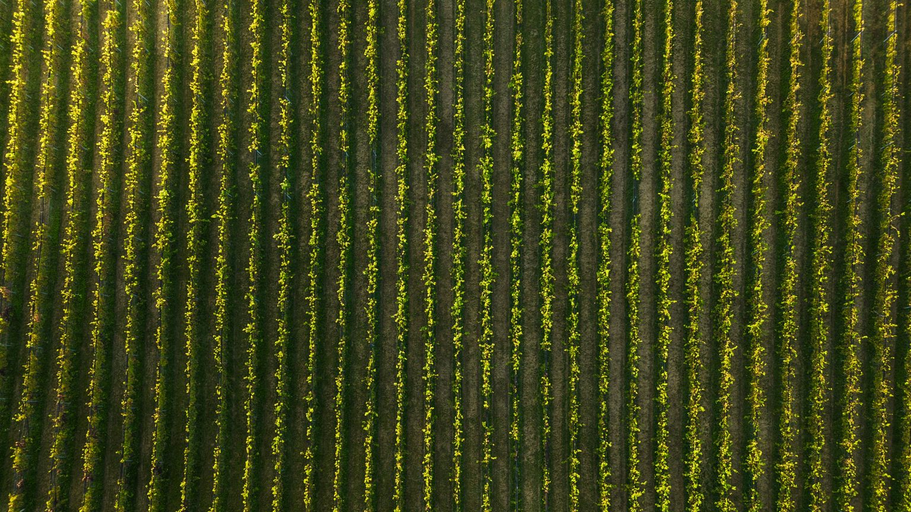
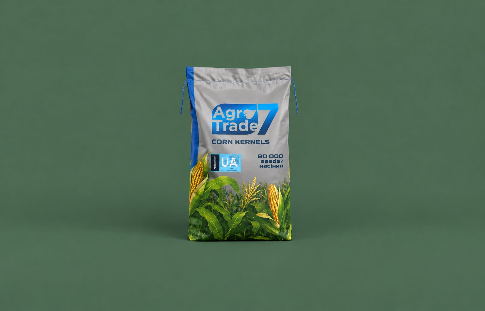

Осінь — час, коли господарство вирішує, що сіяти наступного року. Перша думка зазвичай про те, яка культура дала більше грошей цього сезону. Але рішення за минулорічною ціною часто підводить: поле, ринок і погода наступного року будуть іншими.

У статті розбираємо, як порівняти кукурудзу й соняшник саме для вашого поля. Окремо рахуємо, скільки коштує насіння на гектар за прайсом Agro7Trade на 2026 рік, і підказуємо, які гібриди підійдуть під різні умови.

*Культуру обирають для кожного поля окремо, а не для всього господарства одразу.*

## Почніть не з ціни, а з поля

Ціна врожаю — важливий аргумент, але вона змінюється щороку і її неможливо знати наперед. Натомість умови поля ви знаєте вже зараз. Тому вибір культури логічно будувати від того, що відомо напевно:

1. **Що росло на полі останні роки.** Це визначає, які культури взагалі можна ставити наступними.
2. **Скільки вологи лишилося в ґрунті** і які опади типові для вашої зони.
3. **Які бур'яни і хвороби траплялися** на цьому полі.
4. **Яка є техніка**: сівалки, обприскувачі, жатки, сушарка.
5. **Куди ви продаватимете врожай** і чи є попередні домовленості з елеватором або олієзаводом.

Лише після цього варто порівнювати очікувану виручку. Так ви обираєте з реальних варіантів, а не з усіх культур одразу.

## Сівозміна: що взагалі можна сіяти

Першим відсіює варіанти саме попередник. Соняшник вимогливий до сівозміни: його загальноприйнято повертати на поле не раніше ніж через 6–8 років. Інакше на полі накопичуються вовчок і хвороби. Кукурудза менш вибаглива, але кілька років поспіль на одному полі її теж краще не тримати.

Добрі попередники для обох культур — озимі колосові. Кукурудза добре йде після зернобобових. Соняшник не варто ставити після ріпаку чи сої, бо всі вони уражуються білою гниллю. Детально про попередники розповідаємо в статті [про сівозміну на 2027 рік](/blog/sivozmina-kukurudza-sonyashnyk-poperednyky/).

## Кукурудза і соняшник: порівняння

Нижче загальні відмінності культур, які варто врахувати при виборі. Це не рейтинг, а список того, що впливає на рішення.

| Що порівнюємо | Кукурудза | Соняшник |
|---|---|---|
| Повернення на поле | можна частіше, але не кілька років поспіль | зазвичай не раніше ніж через 6–8 років |
| Потреба у волозі | висока, особливо в період цвітіння | глибоке коріння допомагає пережити посуху, але сильно висушує ґрунт |
| Тривалість вегетації | залежить від ФАО гібрида | у гібридах Agro7Trade 105–120 днів |
| Контроль бур'янів | стандартні схеми захисту | можна обрати гербіцидну технологію: Гранстар, Clearfield або класика |
| Збирання | зерно часто доводиться досушувати | збирають зазвичай раніше за кукурудзу на зерно |
| Насіння на гектар | дорожче через вищу норму висіву | дешевше на гектар |

Якщо поле сухе і соняшник давно не сіяли, він часто стає логічним вибором. Якщо волога є, соняшник був на полі недавно, а сушарка в господарстві є, частіше виграє кукурудза.

## Скільки коштує насіння на гектар

Вартість насіння рахується за простою формулою: норма висіву ділиться на кількість насінин в одній посівній одиниці і множиться на ціну одиниці. У Agro7Trade посівна одиниця кукурудзи містить 80 000 насінин, соняшника — 150 000.

Нижче умовні розрахунки за прайсом Agro7Trade. Норма висіву зазвичай трохи вища за рекомендовану густоту на час збирання, тому точну цифру для свого поля уточнюйте окремо.

**Кукурудза, ціна за посівну одиницю:**

| Норма висіву, тис. насінин/га | Посівних одиниць на га | Фракція до 200 г (2 150 грн) | Фракція від 200 г (3 400 грн) |
|---|---|---|---|
| 60 | 0,75 | ≈ 1 610 грн | ≈ 2 550 грн |
| 70 | 0,875 | ≈ 1 880 грн | ≈ 2 975 грн |
| 80 | 1,0 | 2 150 грн | 3 400 грн |

**Соняшник, ціна за посівну одиницю:**

| Норма висіву, тис. насінин/га | Посівних одиниць на га | Економ (2 800 грн) | Екстра (3 800 грн) | Набаро, Економ (2 100 грн) |
|---|---|---|---|---|
| 50 | 0,33 | ≈ 930 грн | ≈ 1 270 грн | ≈ 700 грн |
| 55 | 0,37 | ≈ 1 030 грн | ≈ 1 390 грн | ≈ 770 грн |
| 60 | 0,40 | ≈ 1 120 грн | ≈ 1 520 грн | ≈ 840 грн |

Ціни за всіма фракціями є в прайсі на сторінці кожного гібрида, наприклад [у прайсі соняшника](/product/sonyashnyk-kaskara/#prais) або [у прайсі кукурудзи](/product/kukurudza-samariya-fao-300/#prais).

Насіння — лише одна стаття витрат. До повної вартості гектара входять добрива, засоби захисту, пальне, збирання і для кукурудзи часто сушіння. Порівнюйте культури за повною вартістю, а не тільки за ціною насіння.

*Рівні сходи без пропусків — результат правильно розрахованої норми висіву.*

## Який гібрид обрати під свої умови

Коли культуру обрано, наступний крок — гібрид. Кілька підказок за гібридами Agro7Trade.

**Кукурудза:**

- для ранньої сівби і полів з обмеженою сумою температур — [«Ангора»](/product/kukurudza-angora-fao-270/), ФАО 270;
- для балансу потенціалу і вологовіддачі — [«Самарія»](/product/kukurudza-samariya-fao-300/), ФАО 300;
- для вищого потенціалу і силосу, якщо тепла достатньо, — [«Сігірія»](/product/kukurudza-sigiriya-fao-350/), ФАО 350.

Детальніше про різницю між ними — у статті [про вибір гібрида кукурудзи на 2027 рік](/blog/yakyi-hibrid-kukurudzy-na-2027-angora-samariia-chy-sigiriia/).

**Соняшник:**

- для полів з вовчком і змішаною забур'яненістю — [«Браун»](/product/sonyashnyk-braun/) (Clearfield Plus, вовчок A–G) або [«Ласса»](/product/sonyashnyk-lassa/) (Clearfield, A–F);
- для технології Гранстар — [«Каскара»](/product/sonyashnyk-kaskara/) або [«Лусон»](/product/sonyashnyk-luson/);
- для чистих полів і класичної технології, з найвищою олійністю в лінійці, — [«Набаро»](/product/sonyashnyk-nabaro/).

Як підібрати гібрид під гербіцидну технологію, пояснюємо в [окремій статті](/blog/yak-obraty-gibryd-sonyashnyka-pid-tekhnologiyu/).

## Ринок збуту і ризики сезону

Ціну врожаю наступного року ніхто не знає наперед, але ризики можна зменшити. Перед вибором культури варто дізнатися, куди і на яких умовах ви зможете продати урожай: чи є поруч елеватор або олієзавод, які вимоги до вологості та якості зерна, чи можна домовитися про постачання заздалегідь.

Корисно також оцінити, що буде в несприятливий рік. Кукурудза сильніше страждає від посухи в період цвітіння, а соняшник краще переносить нестачу вологи, але гірше реагує на часті повтори в сівозміні. Якщо господарство не може дозволити собі поганий рік на всій площі, частину полів можна засіяти кукурудзою, а частину соняшником. Так ризики розподіляються, а сівозміна стає збалансованішою.

Ще один практичний аргумент — робота техніки. Різні строки сівби і збирання кукурудзи й соняшника дозволяють рівномірніше завантажити сівалки, комбайни та людей, ніж коли все поле під однією культурою.

## Типові помилки при виборі культури

- Обирати культуру за ціною цього сезону і не дивитися на сівозміну.
- Сіяти соняшник на полі, де він був 2–3 роки тому, бо зараз він вигідніший.
- Рахувати лише вартість насіння, а не повну вартість гектара.
- Обирати кукурудзу пізнього ФАО без сушарки і без запасу тепла в регіоні.
- Відкладати рішення до весни, коли на закупівлю і підготовку вже немає часу.

*Коли план полів готовий, легко порахувати, скільки посівних одиниць і яких гібридів потрібно.*

## Як скласти план на 2027 рік

Найпростіше зробити таблицю на всі поля. Для кожного запишіть попередні культури, ризики, обрану культуру, гібрид і кількість посівних одиниць. Тоді кількість насіння для закупівлі рахується одразу, а не навмання.

Умовний приклад для поля 50 га під кукурудзу з нормою 70 тисяч насінин на гектар: 50 × 0,875 = 43,75, тобто приблизно 44 посівні одиниці. Для поля 50 га під соняшник з нормою 55 тисяч: 50 × 0,37 ≈ 18,5, тобто приблизно 19 посівних одиниць. Невеликий запас на пересів варто закласти окремо. Якщо план охоплює кілька гібридів, рахуйте кількість окремо для кожного, бо норма висіву і ціна фракцій у них різні.

Купивши насіння восени чи взимку, зберігайте його правильно, щоб не втратити схожість до весни. Як це зробити, розповідаємо в статті [про зберігання насіння до весни](/blog/yak-zberigaty-nasinnya-kukurudzy-ta-sonyashnyka-do-vesny/).

## Часті запитання

### Що вигідніше сіяти у 2027 році: кукурудзу чи соняшник?

Універсальної відповіді немає. Вигідність залежить від того, що росло на полі раніше, скільки там вологи, які бур'яни переважають, чи є сушарка і куди ви продаватимете врожай. Порівнюйте культури для кожного поля окремо, а не для всього господарства одразу.

### Чи можна посіяти соняшник, якщо він уже був на цьому полі два роки тому?

Не варто. Загальноприйнята рекомендація — повертати соняшник на поле не раніше ніж через 6–8 років, інакше накопичуються вовчок і хвороби. Для такого поля логічніше обрати кукурудзу або іншу культуру.

### Скільки посівних одиниць насіння потрібно на гектар?

Поділіть норму висіву на кількість насінин в одній посівній одиниці. Для кукурудзи Agro7Trade це 80 000 насінин, для соняшника — 150 000. Умовно: 70 тисяч насінин кукурудзи на гектар — це 0,875 посівної одиниці.

### Чим відрізняються фракції насіння кукурудзи до 200 г і від 200 г?

Фракція визначається масою 1000 зерен. Від неї залежить ціна посівної одиниці: у прайсі Agro7Trade фракція до 200 г коштує 2 150 грн, від 200 г — 3 400 грн. Кількість насінин в одиниці однакова — 80 000.

### Коли краще купувати насіння на 2027 рік?

Коли вже складено план полів: тоді зрозуміло, скільки посівних одиниць і яких гібридів потрібно. Купуючи насіння заздалегідь, ви встигаєте перевірити схожість і правильно організувати зберігання до весни.

## Підсумок

Що садити у 2027 році, вирішують умови кожного поля: сівозміна, волога, бур'яни, техніка і ринок збуту. Ціна врожаю важлива, але вона змінюється, а поле — ні. Порахуйте вартість насіння на гектар за прайсом, складіть план полів і підберіть гібриди в каталозі: [кукурудза](/catalog/kukurudza/) і [соняшник](/catalog/sonyashnyk/). Якщо потрібна допомога з вибором, [напишіть нам](/contacts/).
