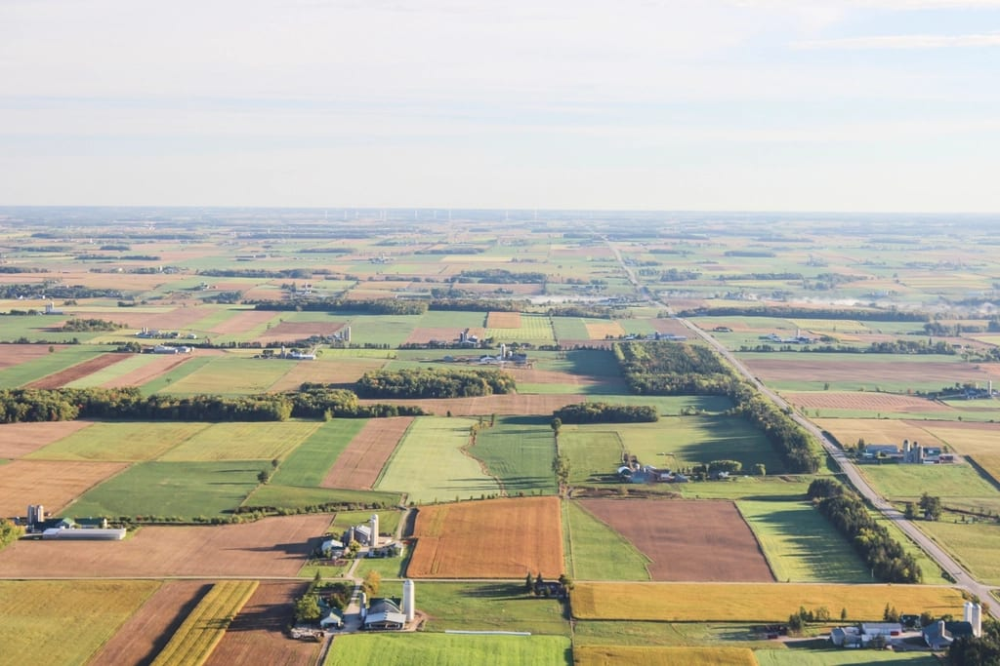
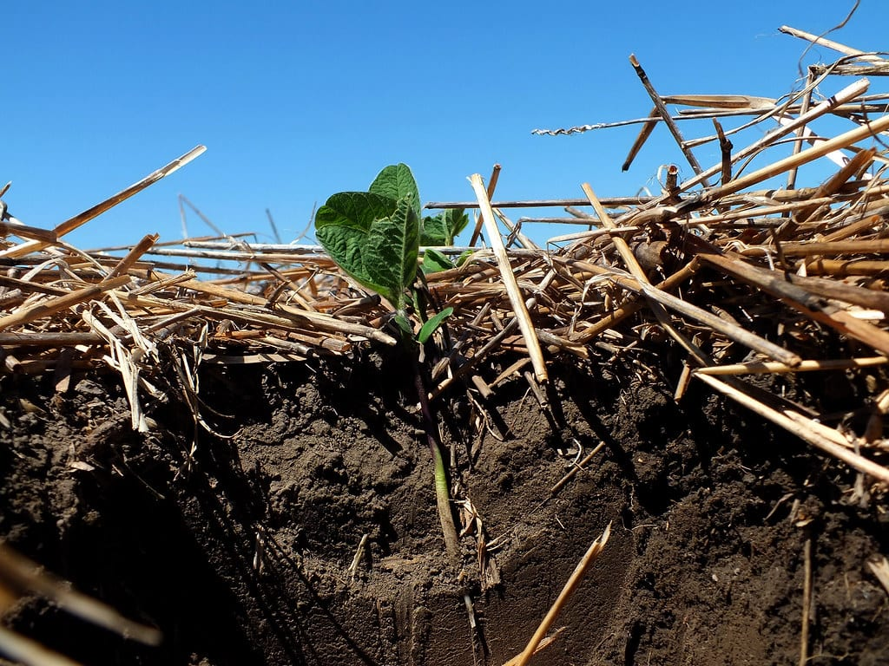
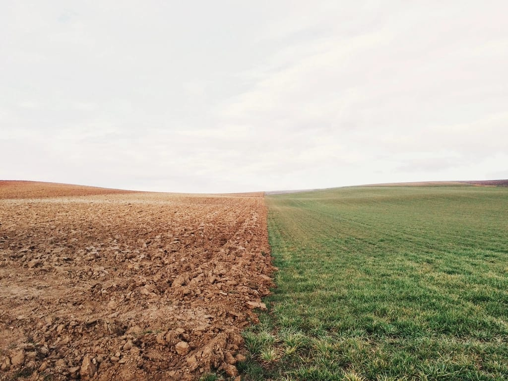

Найкращий гібрид не розкриє потенціалу, якщо поставити його після невдалого попередника. Попередня культура визначає, скільки вологи лишилося в ґрунті, які хвороби та шкідники накопичилися і які бур'яни чекатимуть навесні. Тому планування сезону 2027 варто починати не з вибору насіння, а з карти полів і того, що на них росло.

У статті розбираємо, після яких культур краще сіяти кукурудзу й соняшник, яких поєднань уникати і як скласти план на наступний рік уже зараз, восени.

*Сівозміну планують за картою полів, а не окремо під кожну культуру.*

## Навіщо сівозміна, якщо є добрива й засоби захисту

Добрива відновлюють поживні речовини, а засоби захисту стримують шкідників і хвороби. Але сівозміна робить те, чого не дають жодні препарати:

- **розриває цикл хвороб і шкідників**, які зимують у ґрунті та рослинних рештках і чекають на свою культуру;
- **рівномірніше використовує вологу**, бо культури з різною глибиною коренів беруть воду з різних шарів ґрунту;
- **допомагає контролювати бур'яни**, бо різні культури дають змогу використовувати різні технології захисту;
- **знижує залежність від хімії**, а отже і витрати.

Є й економічний бік. Правильна сівозміна зменшує витрати на засоби захисту і робить урожай стабільнішим від року до року. Для господарства це часто важливіше, ніж рекордний урожай в одному сезоні, після якого поле кілька років дає менше.

Для соняшника є ще одна важлива причина — вовчок. Його насіння роками лежить у ґрунті й чекає наступного посіву соняшника. Чим частіше соняшник повертається на поле, тим швидше паразит накопичується. Детальніше про це — у статті [про вовчок і стійкі гібриди](/blog/vovchok-sonyashnyka-rasy-ta-stiiki-gibrydy/).

## Після чого сіяти кукурудзу

Кукурудза відносно невибаглива до попередників, але різниця між ними помітна.

**Добрі попередники:**

- **озимі колосові.** Рано звільняють поле і дають час на якісний осінній обробіток і накопичення вологи;
- **зернобобові**, наприклад соя чи горох. Вони залишають після себе частину азоту і не мають спільних з кукурудзою головних хвороб.

**Обережно:**

- **кукурудза після кукурудзи.** Короткий повтор можливий, але при кількох роках поспіль накопичуються шкідники та хвороби кукурудзи, зокрема фузаріоз;
- **кукурудза після соняшника.** Соняшник глибоко висушує ґрунт, а його падалиця навесні стає бур'яном у посівах кукурудзи.

Якщо доводиться ставити кукурудзу після не найкращого попередника, допомагає гібрид з високою стійкістю до фузаріозу й посухи. У гібридів Agro7Trade «Ангора», «Самарія» і «Сігірія» стійкість до фузаріозу 9 балів, а посухостійкість 8–9 балів. Як обрати між ними, розповідаємо в статті [про гібриди кукурудзи на 2027 рік](/blog/yakyi-hibrid-kukurudzy-na-2027-angora-samariia-chy-sigiriia/).

*Рештки попередника впливають на вологу, хвороби і сходи наступної культури.*

## Після чого сіяти соняшник

Соняшник вимогливіший до сівозміни, ніж кукурудза.

**Добрі попередники:**

- **озимі колосові.** Класичний і найпоширеніший попередник для соняшника;
- **кукурудза.** У практиці поширений варіант, але в посушливі роки поле після кукурудзи на зерно може мати менший запас вологи.

**Уникайте:**

- **соняшник після соняшника** і короткі повтори. Загальноприйнята рекомендація — повертати соняшник на поле не раніше ніж через 6–8 років;
- **соняшник після ріпаку, сої чи гороху.** Ці культури уражуються білою гниллю, як і соняшник, тому збудник накопичується в ґрунті.

В Україні є державні нормативи оптимального співвідношення культур у сівозмінах для різних регіонів, і соняшник у них обмежений. Перед плануванням варто перевірити їхню чинну редакцію.

## Як урахувати гербіциди попереднього сезону

Про це часто згадують запізно. Частина гербіцидів, зокрема тих, що застосовують у сучасних технологіях вирощування соняшника, має післядію: залишки діючої речовини можуть пошкодити чутливу культуру наступного року.

Тому план сівозміни треба звірити з тим, що вносили на кожному полі цього року. Обмеження щодо наступних культур завжди вказані в етикетці препарату. Чим раніше ви це перевірите, тим менше ризик дізнатися про проблему навесні, коли насіння вже куплене. Як технологія захисту соняшника впливає на вибір гібрида, пояснюємо в статті [про гербіцидні технології](/blog/yak-obraty-gibryd-sonyashnyka-pid-tekhnologiyu/).

## Як скласти план на 2027 рік

Найпростіше зробити це в таблиці. Для кожного поля запишіть:

1. Що росло на полі цього року і в попередні 2–3 роки.
2. Які гербіциди вносили і які в них обмеження щодо наступних культур.
3. Чи були проблеми з вовчком, хворобами або шкідниками.
4. Яку культуру логічно поставити наступною за цими даними.
5. Який гібрид підходить під це поле і його зону.

Приклад умовного плану для невеликого господарства:

| Поле | 2026 | Ризики | План на 2027 |
|---|---|---|---|
| Поле 1 | озима пшениця | немає | соняшник |
| Поле 2 | соняшник | вовчок на частині поля | кукурудза |
| Поле 3 | кукурудза на зерно | сухий ґрунт після посушливої осені | соя або колосові |
| Поле 4 | соя | біла гниль у минулому | кукурудза, не соняшник |

Це приклад логіки, а не готова схема, і поля в ньому умовні. У кожному господарстві свої поля, ґрунти й ринок збуту, тому рішення приймайте за власними записами.

*Осінь — найзручніший час, щоб скласти план полів на наступний сезон.*

## Як попередник впливає на вологу

Для більшості господарств України волога — головний обмежувальний фактор урожаю. Тому попередник оцінюють насамперед за тим, скільки вологи він лишає в ґрунті.

Культури з глибоким корінням, як соняшник, беруть воду з глибоких шарів. Після них поле потребує більше часу і опадів, щоб відновити запас. Колосові звільняють поле раніше, і за осінь та зиму ґрунт встигає накопичити більше вологи. Кукурудза на зерно звільняє поле пізно і теж використовує багато води.

Тому в посушливих регіонах особливо важливо не ставити поспіль культури, які сильно висушують ґрунт. Якщо такого поєднання не уникнути, допомагають гібриди з високою посухостійкістю і нижча густота посіву.

## Пожнивні рештки і обробіток

Різні попередники лишають різну кількість решток. Після кукурудзи на зерно їх багато, і вони повільно розкладаються. Рештки захищають ґрунт від ерозії і зберігають вологу, але можуть заважати сівбі і бути джерелом інфекцій, зокрема фузаріозу.

Тому обробіток під наступну культуру планують з урахуванням попередника. Важливо подрібнити рештки і рівномірно розподілити їх по полю, щоб сівалка якісно загорнула насіння. На полях, де були хвороби, рештки особливо небезпечні, і це ще один аргумент не повторювати ту саму культуру.

## Сівозміна і вибір гібрида

Сівозміна і гібрид доповнюють одне одного. Коли попередник не найкращий, правильний гібрид частково компенсує ризики:

- **після культур, що висушують ґрунт**, обирайте гібриди з високою посухостійкістю;
- **на полях із історією фузаріозу** дивіться на стійкість до нього в характеристиках гібрида;
- **на полях із вовчком** обирайте соняшник з ширшим діапазоном стійкості до рас;
- **якщо поле пізно звільнилося**, а весна холодна, корисна холодостійкість гібрида для ранньої сівби.

Плануючи поля на 2027 рік, запишіть ці ризики поруч із кожним полем. Тоді вибір гібрида стане простим: ви підбираєте його не «взагалі», а під конкретні умови.

## Сівозміна, коли полів небагато

У великому господарстві сівозміну легко розкласти на десяток полів. У невеликому, де два-три поля, це складніше, і спокуса посіяти найвигіднішу культуру всюди дуже велика.

Кілька підходів, які допомагають:

- **ділити поле на частини.** Одне велике поле можна розбити на дві-три ділянки під різні культури, щоб чергувати їх по роках;
- **чергувати не тільки кукурудзу й соняшник.** Колосові або зернобобові між ними дають полю відпочити від спільних хвороб і шкідників;
- **не гнатися за ціною одного сезону.** Соняшник, посіяний занадто часто заради вигідної ціни, за кілька років може дати проблеми з вовчком і хворобами, які обійдуться дорожче;
- **вести записи навіть на двох полях.** Через кілька років пам'ять підводить, а записи показують точну історію.

Сівозміна в малому господарстві не обов'язково ідеальна. Головне — уникати найризикованіших поєднань і не повертати соняшник надто часто.

## Типові помилки

- Повертати соняшник на поле через 2–3 роки, бо він вигідний цього сезону.
- Ставити соняшник після ріпаку чи сої і дивуватися білій гнилі.
- Не перевірити післядію гербіциду попередньої культури.
- Планувати сівозміну навесні, коли вже немає часу змінити закупівлю насіння.
- Не вести записів по полях і покладатися на пам'ять.

## Часті запитання

### Як часто можна повертати соняшник на те саме поле?

Загальноприйнята рекомендація — не раніше ніж через 6–8 років. Довша перерва стримує вовчок і хвороби, спільні для соняшника та інших культур. Перевірте також чинні нормативи щодо сівозмін для вашого регіону.

### Чи можна сіяти кукурудзу після кукурудзи?

Можна, але недовго. Повторні посіви накопичують шкідників і хвороби кукурудзи, тому краще чергувати її з іншими культурами і не тримати на одному полі кілька років поспіль.

### Чи погано сіяти соняшник після кукурудзи?

У практиці це поширений варіант. Головний ризик — сухий ґрунт після кукурудзи на зерно в посушливі роки. Якщо осінь і зима були посушливими, поле після кукурудзи може мати менший запас вологи для соняшника.

### Чому не варто сіяти соняшник після ріпаку чи сої?

Ці культури уражуються білою гниллю, як і соняшник. Якщо поставити їх поруч у сівозміні, збудник накопичується в ґрунті, і ризик хвороби для соняшника зростає.

### Коли планувати сівозміну на наступний рік?

Восени, після збирання. Тоді вже відомий стан кожного поля, а до весни лишається час закупити насіння потрібних гібридів і перевірити обмеження гербіцидів щодо наступних культур.

## Підсумок

Сівозміна — найдешевший спосіб захистити майбутній урожай. Кукурудза добре йде після колосових і зернобобових, соняшник — після колосових і кукурудзи, але не частіше ніж раз на 6–8 років і не після культур, що уражуються білою гниллю. Складіть план полів на 2027 рік зараз, а потім підберіть під нього гібриди: [кукурудза](/catalog/kukurudza/) і [соняшник](/catalog/sonyashnyk/). Якщо потрібна допомога з підбором, [напишіть нам](/contacts/).
