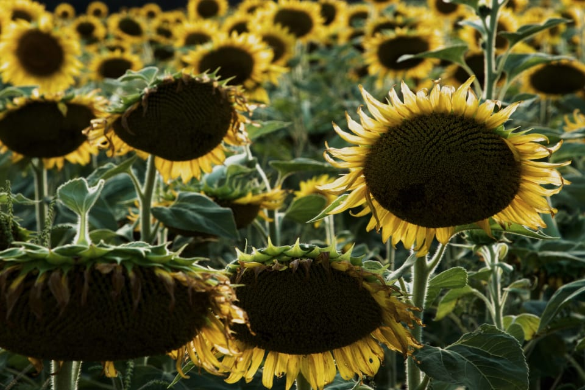
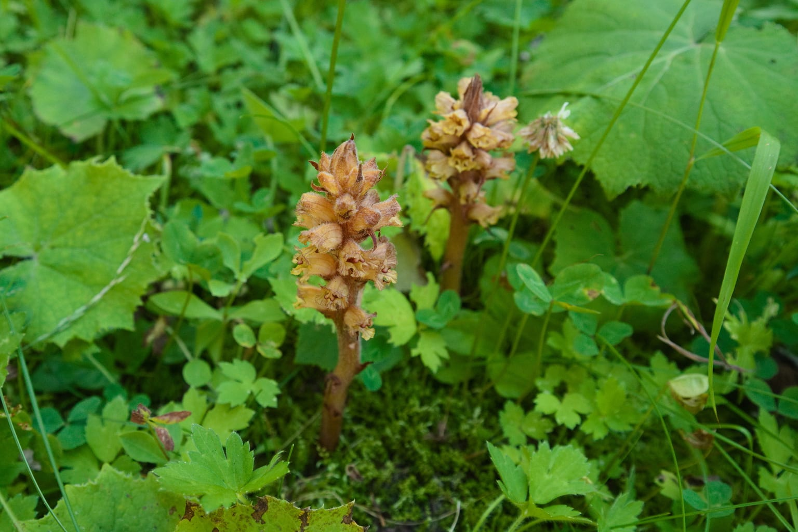
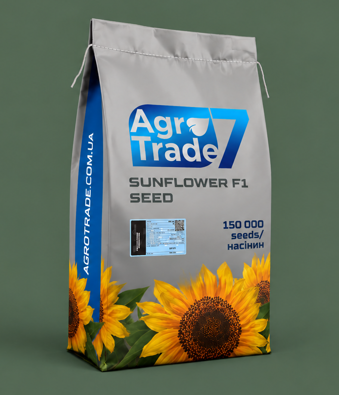

Вовчок, його ще називають заразихою, — одна з найдорожчих проблем соняшника в Україні. Це не хвороба і не бур'ян у звичному розумінні, а рослина-паразит. Вона не має власного зеленого листя і живе за рахунок соняшника, присмоктуючись до його коренів. На сильно заражених полях соняшник формує дрібні кошики або не формує врожаю зовсім.

У статті розбираємо, як влаштований вовчок, що означають раси, як його помітити і як захищатися: гібридом, сівозміною і технологією.

*Ураження вовчком часто видно лише тоді, коли соняшник уже відстає в рості.*

## Що таке вовчок і чим він небезпечний

Вовчок соняшниковий живе під землею більшу частину свого циклу. Його насіння лежить у ґрунті й проростає, коли поруч з'являються корені соняшника. Проросток присмоктується до кореня і починає забирати воду й поживні речовини. Над поверхнею паразит з'являється пізніше, коли шкода вже завдана.

Небезпека вовчка в трьох речах:

- **він забирає ресурси соняшника**, тому рослина слабшає, кошик дрібнішає, а олійність падає;
- **одна рослина вовчка дає дуже багато дрібного насіння**, яке легко розноситься ґрунтом, технікою і вітром;
- **насіння вовчка довго зберігається в ґрунті**, за різними даними — багато років, тому заражене поле лишається небезпечним надовго.

Через це з вовчком неможливо впоратися одним прийомом за один сезон. Захист будується на кількох рівнях одночасно.

Чому вовчок такий поширений саме в Україні? Соняшник у нас — одна з найвигідніших культур, тому його часто сіють частіше, ніж дозволяє сівозміна. Кожен такий посів дає паразиту нову нагоду розмножитися і пристосуватися. Саме тому проблема з роками не зменшується, а агресивні раси поширюються на нові регіони.

## Що означають раси вовчка

Вовчок постійно пристосовується до стійких гібридів. Коли селекціонери створюють гібрид, який стримує поширений тип паразита, з часом з'являються форми, які цю стійкість долають. Такі форми називають расами і позначають латинськими літерами: A, B, C і далі.

Чим далі літера в алфавіті, тим агресивніша раса. Тому в характеристиках гібрида стійкість записують діапазоном:

- **стійкість до рас A–F** означає, що гібрид стримує раси від A до F включно;
- **стійкість до рас A–G** означає, що гібрид додатково стримує расу G.

Важливо розуміти межу. Якщо на полі поширена раса, агресивніша за верхню літеру в характеристиках, генетичний захист гібрида не гарантований. У південних і східних регіонах України повідомляють про поширення агресивніших рас, тому там на верхню літеру стійкості варто дивитися особливо уважно.

## Як знайти вовчок на полі

Над поверхнею вовчок виглядає як групи товстих стебел без зеленого листя, жовтуватого, бурого або фіолетового відтінку, біля основи соняшника. Найчастіше він стає помітним у другій половині вегетації.

Що варто робити:

1. Оглядайте поле в період від бутонізації до цвітіння, а не лише після.
2. Звертайте увагу на рослини, що відстають у рості або в'януть без видимої причини.
3. Викопайте кілька таких рослин і огляньте корені: паразит видно як потовщення і прикріплені до коренів пагони.
4. Позначте ділянки з ураженням на карті поля, щоб урахувати їх при плануванні сівозміни.

Записи про ураження корисні навіть тоді, коли врожай цього року вже не врятувати. Вони підкажуть, який гібрид і яку технологію обрати наступного разу.

*Так виглядає рослина роду вовчок. На фото дикорослий вид, але вовчок соняшниковий має схожу будову: товсте стебло без зеленого листя.*

## Три рівні захисту

### Гібрид зі стійкістю до потрібних рас

Це основа захисту. Обирайте гібрид, верхня літера стійкості якого покриває раси, поширені у вашому регіоні. Якщо в зоні вже фіксували агресивніші раси, гібрид зі стійкістю A–G дає більший запас, ніж A–F.

### Сівозміна з довгою перервою

Чим частіше соняшник повертається на те саме поле, тим швидше накопичується насіння вовчка і тим швидше з'являються агресивніші раси. Довга перерва між посівами соняшника — найдешевший спосіб стримати паразита. Як правильно вибудувати сівозміну, розповідаємо в статті [про попередники для кукурудзи й соняшника](/blog/sivozmina-kukurudza-sonyashnyk-poperednyky/).

### Технологія Clearfield

Для технології Clearfield заявлено хімічний контроль вовчка: гербіцид, який вноситься на стійкий гібрид, стримує й паразита. Це додатковий рівень захисту, а не заміна стійкому гібриду. Детальніше про різницю між технологіями — у статті [про вибір гібрида соняшника під технологію](/blog/yak-obraty-gibryd-sonyashnyka-pid-tekhnologiyu/).

## Стійкість гібридів Agro7Trade

Усі п'ять гібридів соняшника в нашому каталозі мають заявлену стійкість до вовчка. Різниця — у верхній расі та в технології.

| Гібрид | Стійкість до вовчка | Технологія | Що це означає |
|---|---|---|---|
| Лусон | раси A–G | Гранстар / SUMO / ExpressSun | ширший генетичний захист |
| Набаро | раси A–G | класична | ширший генетичний захист |
| Каскара | раси A–F | ExpressSan (Гранстар) | генетичний захист до раси F |
| Ласса | раси A–F | Clearfield | генетичний захист плюс хімічний контроль |
| Браун | раси A–G | Clearfield Plus | ширший генетичний захист плюс хімічний контроль |

Як цим скористатися на практиці:

- якщо в регіоні поширена раса G, логічно дивитися на [«Лусон»](/product/sonyashnyk-luson/) або [«Набаро»](/product/sonyashnyk-nabaro/);
- якщо на полі сильна забур'яненість і вовчок, варто розглянути [«Лассу»](/product/sonyashnyk-lassa/), бо технологія Clearfield дає контроль і бур'янів, і паразита;
- якщо вовчок агресивний, а поле ще й забур'янене, найбільший запас дає [гібрид «Браун»](/product/sonyashnyk-braun/): стійкість до рас A–G і технологія Clearfield Plus;
- якщо вовчок на полі не фіксували, а важливі коротка вегетація й потужна коренева система, підійде [«Каскара»](/product/sonyashnyk-kaskara/).

*Стійкість до вовчка для кожного гібрида вказана на його сторінці і в прайсі.*

## Як вовчок потрапляє на чисті поля

Насіння вовчка дуже дрібне, тому переноситься легко і непомітно. Найчастіші шляхи:

- **техніка.** Ґрунт на колесах, робочих органах культиваторів і жатках переносить насіння з зараженого поля на чисте;
- **вітер і вода.** Дрібне насіння розноситься вітром і талою водою з сусідніх ділянок;
- **ґрунт і рослинні рештки**, які потрапляють на поле разом з технікою чи під час робіт на межах полів.

Тому на зараженому полі варто працювати останнім, а після роботи очищати техніку від ґрунту. Це проста дія, яка помітно сповільнює поширення паразита по господарству.

## Що робити, якщо вовчок уже на полі

Якщо цього сезону на полі знайшли вовчок, урожай поточного року врятувати вже складно. Але можна підготуватися до наступних сезонів.

1. **Позначте осередки на карті поля.** Це допоможе оцінити масштаб проблеми і відстежувати, чи вона росте.
2. **Збільште перерву до наступного соняшника.** На полі з вовчком соняшник варто повертати якомога рідше.
3. **Наступного разу обирайте гібрид з ширшим діапазоном стійкості**, а на сильно засмічених полях розгляньте технологію Clearfield.
4. **Не допускайте дозрівання насіння вовчка**, якщо осередки невеликі і їх можна видалити до цвітіння паразита.
5. **Порівняйте результати** різних гібридів на сусідніх ділянках, якщо є така можливість. Це найнадійніший спосіб дізнатися, що працює саме на вашому полі.

Якщо вовчок з'явився на гібриді із заявленою стійкістю, це сигнал, що на полі може бути агресивніша раса. У такому випадку варто звернутися до фахівців для визначення раси.

## Як порівнювати гібриди за стійкістю до вовчка

У каталогах стійкість до вовчка зазвичай вказують у розділі стійкості або в описі гібрида. Шукайте саме діапазон рас, а не загальні слова на кшталт «стійкий до вовчка». Без діапазону неможливо зрозуміти, чи захистить гібрид від рас, поширених у вашій зоні.

Перед покупкою корисно поставити продавцю кілька питань:

- від яких саме рас вовчка захищає гібрид;
- за якою технологією він вирощується і чи дає вона додатковий контроль паразита;
- чи є результати гібрида у вашому регіоні або в сусідніх господарствах;
- яка густота посіву рекомендована для вашої зони.

Відповіді на ці питання дають більше користі, ніж порівняння лише за потенціалом урожайності. Гібрид з високим потенціалом, але без потрібної стійкості, на полі з вовчком цей потенціал не реалізує.

У каталозі Agro7Trade діапазон рас вказано на сторінці кожного гібрида соняшника в розділі стійкості, разом зі стійкістю до хвороб.

## Типові помилки

- Покладатися лише на гербіцид і не дивитися на расу, від якої захищає гібрид.
- Повертати соняшник на поле частіше, ніж дозволяє сівозміна.
- Не чистити техніку після роботи на зараженому полі, переносячи насіння вовчка на чисті ділянки.
- Оглядати поле лише перед збиранням, коли змінити вже нічого не можна.
- Вважати, що якщо вовчка не видно над землею, його немає.

*Стійкий гібрид — основа захисту, але без сівозміни він працює гірше.*

## Часті запитання

### Чи можна позбутися вовчка за один сезон?

Ні. Насіння вовчка зберігається в ґрунті багато років, тому одним сезоном проблему не вирішити. Працює тільки поєднання стійких гібридів, довгої перерви між посівами соняшника і, за потреби, технології Clearfield.

### Що означає стійкість до рас A–F і A–G?

Літери позначають раси вовчка, які гібрид здатен стримувати. Гібрид із стійкістю A–G захищений від тих самих рас, що й A–F, і додатково від раси G. Від агресивніших рас, ніж зазначено, генетичний захист не гарантований.

### Як дізнатися, яка раса вовчка поширена на моєму полі?

Точно визначити расу можна лише лабораторним аналізом. На практиці орієнтуються на дані про поширення рас у регіоні, досвід сусідніх господарств і на те, які гібриди на полі вже уражувалися.

### Чи вражає вовчок соняшника інші культури?

Вовчок соняшниковий паразитує насамперед на соняшнику. Але насіння вовчка залишається в ґрунті й чекає наступного посіву соняшника, тому довга перерва в сівозміні важлива навіть тоді, коли між ними ростуть інші культури.

### Чи допомагає гербіцид проти вовчка?

Для технології Clearfield заявлено хімічний контроль вовчка. Для інших технологій головний захист — генетична стійкість гібрида та сівозміна. Гербіцид не замінює стійкого гібрида на полі з агресивними расами.

## Підсумок

Вовчок не перемогти одним прийомом. Стійкий гібрид з потрібним діапазоном рас, довга перерва в сівозміні і, де це потрібно, технологія Clearfield разом дають надійний захист. Порівняти стійкість гібридів можна в [каталозі соняшника](/catalog/sonyashnyk/). Якщо на вашому полі вже був вовчок і ви не впевнені, який гібрид обрати на 2027 рік, [напишіть нам](/contacts/).
