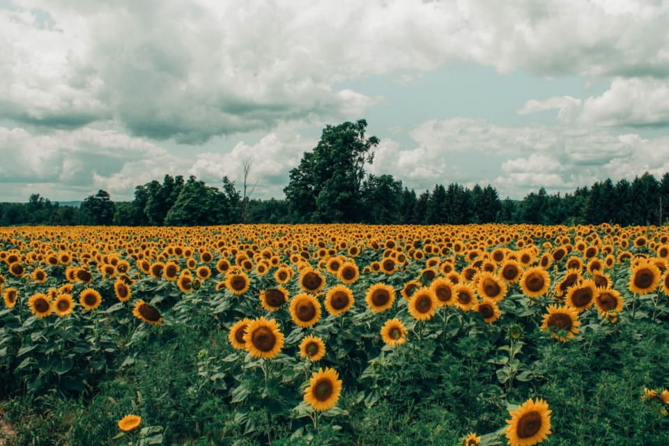
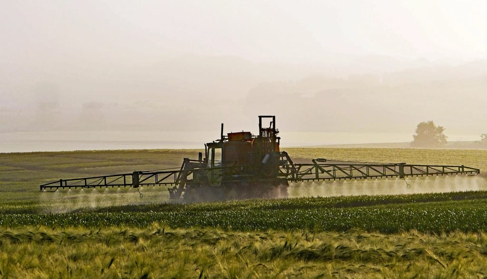
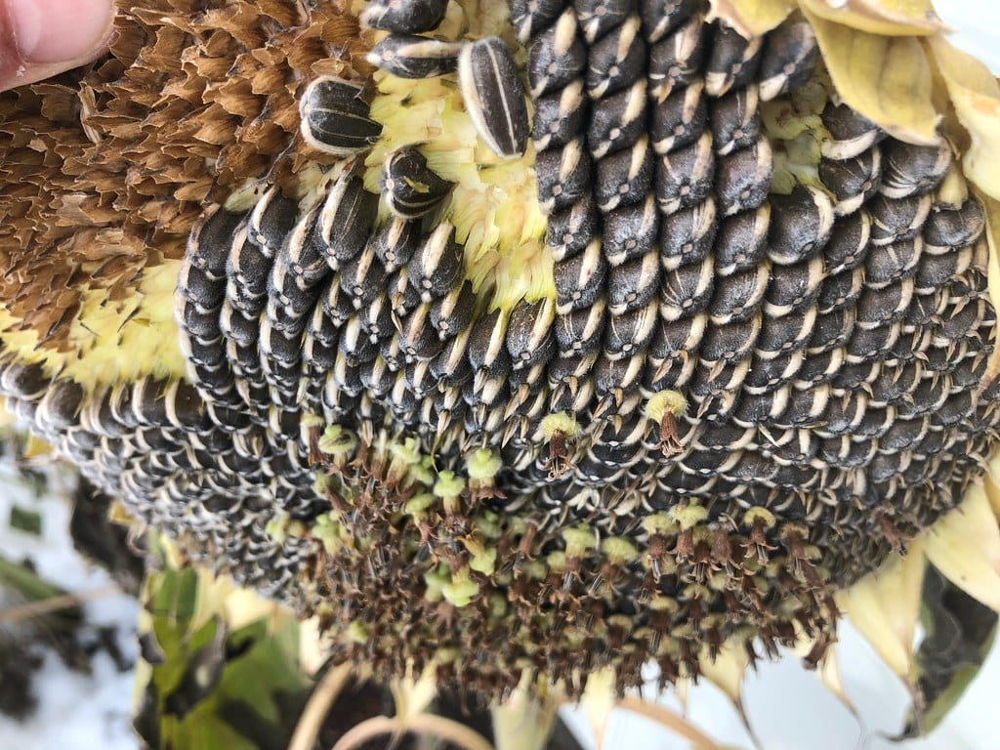

Вибір гібрида соняшника часто починають з потенціалу врожайності або олійності. Але на полі з серйозною забур'яненістю першим питанням має бути інше: яким гербіцидом ви будете чистити посіви. Від відповіді залежить, який гібрид взагалі можна сіяти на цьому полі, бо гербіциди сучасних технологій працюють тільки на гібридах, стійких саме до них.

У статті пояснюємо, чим відрізняються класична технологія, Гранстар і Clearfield, як обрати технологію під своє поле і який гібрид Agro7Trade підходить до кожного варіанту.

*Технологію захисту обирають до сівби, бо після сходів змінити її вже не вийде.*

## Чому технологію обирають раніше за гібрид

На класичному соняшнику бур'яни після сходів контролювати складно: вибір гербіцидів, які не шкодять самій культурі, обмежений. Тому з'явилися гібриди, стійкі до певних діючих речовин. Такий гібрид можна обробити гербіцидом по вегетації, і бур'яни загинуть, а соняшник ні.

Проблема в тому, що кожна технологія працює лише в парі: свій гербіцид і свій гібрид. Гібрид, стійкий до одного гербіциду, не витримає інший. А класичний гібрид не витримає жодного з них. Тому логіка вибору проста: спершу визначаєте технологію під бур'яни поля, потім обираєте гібрид серед тих, що їй відповідають.

## Три технології: у чому різниця

### Класична технологія

Основний захист від бур'янів будується на ґрунтових гербіцидах до сходів і на агротехніці: обробітку ґрунту, міжрядних культиваціях, своєчасній сівбі. Технологія не прив'язує вас до конкретного препарату і зазвичай дешевша за насінням. Вона добре працює на полях з помірною забур'яненістю і там, де можна якісно провести міжрядний обробіток.

### Гранстар (ExpressSun, SUMO)

Гібриди цієї групи стійкі до гербіцидів на основі трибенурон-метилу. Технологію застосовують передусім проти дводольних бур'янів, які важко контролювати на класичному соняшнику. Назви ExpressSun, SUMO і Гранстар у каталогах стосуються сумісності гібрида з препаратами цієї групи, тому дивіться саме на заявлену сумісність у характеристиках гібрида.

### Clearfield

Гібриди Clearfield стійкі до гербіцидів імідазолінонового класу, наприклад Євро-Лайтнінг. Технологія дає ширший спектр контролю, ніж Гранстар, і для неї заявлений хімічний контроль вовчка. Тому Clearfield часто обирають для полів, де є проблема заразихи. Детальніше про вовчок і його раси — в окремій статті [про вовчок соняшника](/blog/vovchok-sonyashnyka-rasy-ta-stiiki-gibrydy/).

*Гербіцид по вегетації можна вносити лише на гібриди, стійкі саме до нього.*

## Як обрати технологію під своє поле

Почніть з обстеження поля і записів за минулі сезони. Корисно відповісти на кілька питань:

1. Які бур'яни переважають: дводольні, злакові чи змішані?
2. Чи траплявся на полі або в сусідів вовчок, і наскільки сильно?
3. Яка культура буде після соняшника і чи чутлива вона до післядії гербіциду?
4. Чи є техніка і час для міжрядних обробітків?

Якщо поле відносно чисте і міжрядний обробіток можливий, класична технологія часто виправдана. Якщо головна проблема — дводольні бур'яни, варто дивитись на Гранстар. Якщо є вовчок або змішана забур'яненість, логічніше розглянути Clearfield.

Окремо перевірте післядію. Частина гербіцидів залишається в ґрунті й може пошкодити чутливу культуру наступного року. Конкретні обмеження вказані в етикетці препарату, і їх варто звірити з планом сівозміни ще восени. Як планувати сівозміну під кукурудзу й соняшник, розповідаємо в статті [про попередники на 2027 рік](/blog/sivozmina-kukurudza-sonyashnyk-poperednyky/).

## Гібриди Agro7Trade за технологіями

У каталозі чотири гібриди соняшника, і кожен прив'язаний до своєї технології. Нижче порівняння за даними з їхніх характеристик.

| Показник | Лусон | Каскара | Ласса | Набаро |
|---|---|---|---|---|
| Технологія | Гранстар / SUMO / ExpressSun | ExpressSan (Гранстар) | Clearfield (Євролайтнінг) | класична |
| Вегетаційний період, днів | 115–120 | 105–110 | 105–109 | 105 |
| Вміст олії, % | — | 48–49 | 49–50 | 53 |
| Потенціал урожайності, ц/га | високий | 55 | 53 | 53 |
| Стійкість до вовчка, раси | A–G | A–F | A–F | A–G |

Прочерк означає, що в характеристиках гібрида цей показник не вказано.

### Лусон: гнучкість у виборі препарату

«Лусон» сумісний одразу з кількома препаратами групи Гранстар, SUMO і ExpressSun. Це середньостиглий лінолевий гібрид інтенсивного типу з вегетаційним періодом 115–120 днів, найдовшим серед чотирьох. Стійкий до вовчка рас A–G і має високу посухостійкість. Рекомендована густота на час збирання 45–50 тисяч рослин на гектар за недостатнього зволоження і 50–55 тисяч за достатнього. Підходить тим, хто хоче обирати гербіцид за ціною і наявністю, а не бути прив'язаним до одного препарату. Деталі — на [сторінці «Лусона»](/product/sonyashnyk-luson/).

### Каскара: технологія Гранстар і потужне коріння

«Каскара» вирощується за технологією ExpressSan (Гранстар). Вегетаційний період 105–110 днів, вміст олії 48–49%, потенціал урожайності 55 ц/га. У характеристиках відзначено дуже потужну кореневу систему і насіння великого розміру. Стійкість 9 балів до борошнистої роси, іржі, фомопсису, білої гнилі та соняшникової молі, до вовчка — раси A–F. Деталі — на [сторінці «Каскари»](/product/sonyashnyk-kaskara/).

### Ласса: Clearfield для полів з вовчком

«Ласса» — гібрид для технології Clearfield (Євролайтнінг). Вегетаційний період 105–109 днів, вміст олії 49–50%, потенціал урожайності 53 ц/га, середня врожайність 36 ц/га. Гібрид має високу посухостійкість і стійкість до полягання та осипання. Генетична стійкість до вовчка рас A–F, а технологія Clearfield дає додатковий хімічний контроль. Деталі — на [сторінці «Ласси»](/product/sonyashnyk-lassa/).

### Набаро: класика з найвищою олійністю

«Набаро» вирощується за класичною технологією. Вміст олії 53% — найвищий серед гібридів каталогу. Вегетаційний період 105 днів, потенціал урожайності 53 ц/га, середня врожайність 36 ц/га. Стійкий до вовчка рас A–G. Підходить для чистіших полів і господарств, які не хочуть прив'язуватися до гербіциду конкретної технології. Деталі — на [сторінці «Набаро»](/product/sonyashnyk-nabaro/).

*Олійність залежить від гібрида, але реалізується лише за повноцінного живлення.*

## Густота посіву за зонами

Для «Ласси» і «Набаро» в характеристиках вказана густота на час збирання: 55–60 тисяч рослин на гектар у Лісостепу і 50–55 тисяч у Степу. Для «Лусона» густоту дано за зволоженням: 45–50 тисяч за недостатнього і 50–55 тисяч за достатнього. Для «Каскари» густота в характеристиках не вказана, тому її варто уточнити під своє поле.

Загальне правило таке: чим менше вологи, тим нижчою має бути густота. Загущений посів у посушливих умовах дає дрібні кошики й нижчу олійність.

## Як технологія впливає на витрати

Порівнювати технології лише за ціною насіння неправильно. Гібриди під гербіцидні технології зазвичай дорожчі за класичні, але вони можуть заощадити на інших статтях: меншій кількості міжрядних обробітків, нижчих втратах урожаю від бур'янів, менших витратах пального й робочого часу.

Тому корисно порахувати повну вартість захисту одного гектара для кожного варіанту. До неї входять насіння, гербіциди, внесення, обробітки й очікувані втрати від бур'янів, які лишаться. На чистому полі класика часто виграє. На сильно забур'яненому полі різниця в урожаї може перекрити дорожче насіння.

Ще один фактор — ризик. Якщо весна дощова і міжрядний обробіток вчасно провести не вийде, класичний посів може сильно заростати. Гербіцидна технологія дає більше гнучкості в строках. Для господарства з обмеженою технікою це часто вирішальний аргумент.

## Що перевірити перед покупкою насіння

Перед замовленням варто пройти короткий чекліст:

1. Технологія гібрида збігається з гербіцидом, який ви плануєте купити.
2. Гербіцид доступний на ринку у потрібній кількості до весни.
3. Етикетка гербіциду не забороняє ту культуру, яку ви плануєте після соняшника.
4. Стійкість гібрида до вовчка покриває раси, поширені у вашій зоні.
5. Вегетаційний період гібрида вкладається у ваше вікно від сівби до збирання.
6. Густота, рекомендована для гібрида, відповідає зволоженню вашого поля.

Якщо хоч один пункт викликає сумнів, краще уточнити це восени, ніж змінювати план навесні, коли насіння вже на складі.

## Типові помилки при виборі

Найчастіші помилки повторюються щороку:

- обирати гібрид за врожайністю, не перевіривши, чи підходить його технологія до бур'янів поля;
- купувати насіння однієї технології, а гербіцид іншої;
- не врахувати післядію гербіциду на наступну культуру;
- обирати Гранстар для поля з сильним вовчком і покладатися лише на гербіцид;
- не дивитися на расу вовчка, від якої захищає гібрид.

Кожну з цих помилок легко уникнути, якщо планувати технологію восени разом із сівозміною.

## Часті запитання

### Чи можна посіяти класичний гібрид і обробити його гербіцидом Гранстар?

Ні. Гербіциди технологій Гранстар і Clearfield призначені тільки для гібридів, стійких саме до них. Класичний гібрид, оброблений таким препаратом, буде пошкоджений або загине.

### Яка технологія краща: Гранстар чи Clearfield?

Універсально кращої немає. Вибір залежить від того, які бур'яни переважають на полі і чи є на ньому вовчок. Гібриди обох технологій є в каталозі, і їх варто порівнювати за характеристиками під конкретне поле.

### Чим лінолевий гібрид відрізняється від високоолеїнового?

Типом олії, тобто співвідношенням жирних кислот. Лінолевий соняшник — звичайний тип, який приймає більшість олієзаводів. Високоолеїновий вирощують зазвичай під окремий контракт. Гібрид «Лусон» лінолевого типу.

### Чи впливає гербіцидна технологія на наступну культуру в сівозміні?

Може впливати. Частина гербіцидів має післядію на чутливі культури, тому обмеження щодо наступних культур треба перевірити в етикетці конкретного препарату ще до сівби соняшника.

### Який гібрид обрати, якщо на полі є вовчок?

Дивіться на расовий склад вовчка у вашій зоні і на стійкість гібрида. У нашому каталозі «Лусон» і «Набаро» стійкі до рас A–G, «Каскара» і «Ласса» — до рас A–F. «Ласса» вирощується за технологією Clearfield, яка дає додатковий хімічний контроль вовчка.

## Підсумок

Гібрид соняшника обирають у парі з гербіцидною технологією, а технологію — під бур'яни конкретного поля. Класика підходить для чистих полів, Гранстар допомагає з дводольними бур'янами, Clearfield дає ширший контроль і захист від вовчка. Усі чотири гібриди Agro7Trade з характеристиками й цінами є в [каталозі соняшника](/catalog/sonyashnyk/). Коли сіяти обраний гібрид, читайте в статті [про строки сівби соняшника](/blog/koly-siyaty-sonyashnyk-stroky-ta-temperatura-gruntu/). Якщо не впевнені, яка технологія підійде вашому полю, [напишіть нам](/contacts/).
